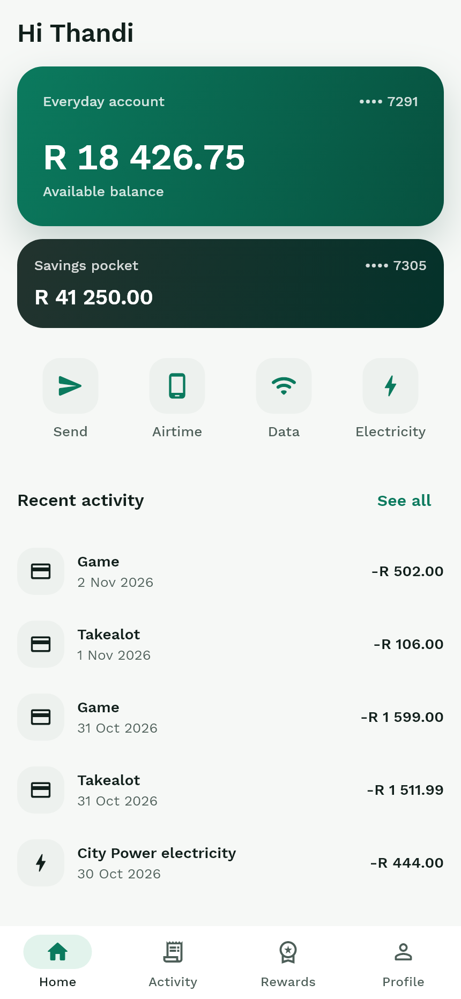
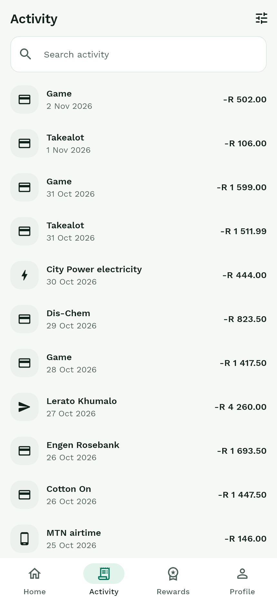
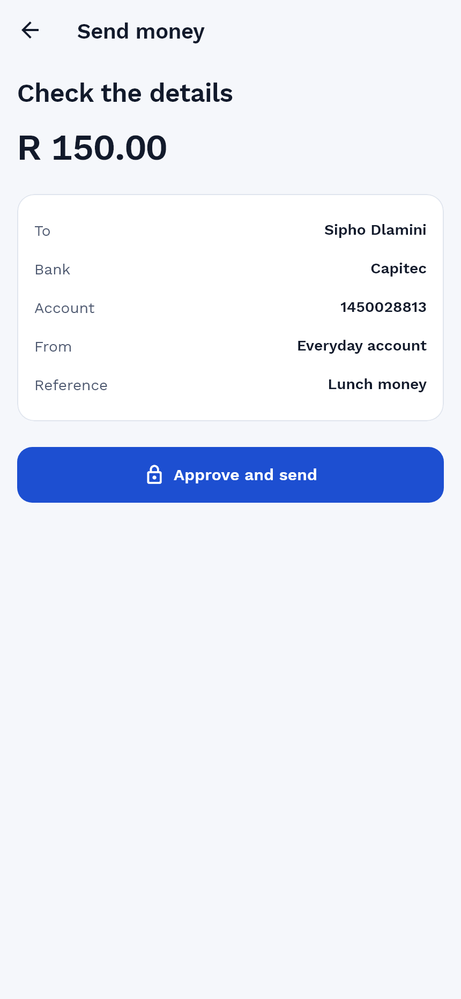
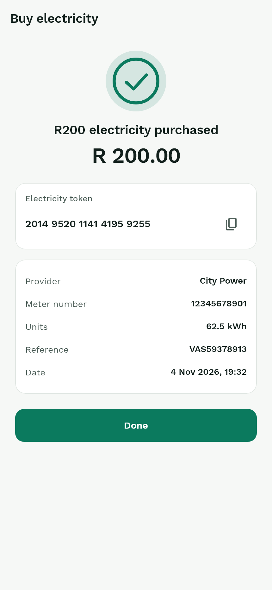
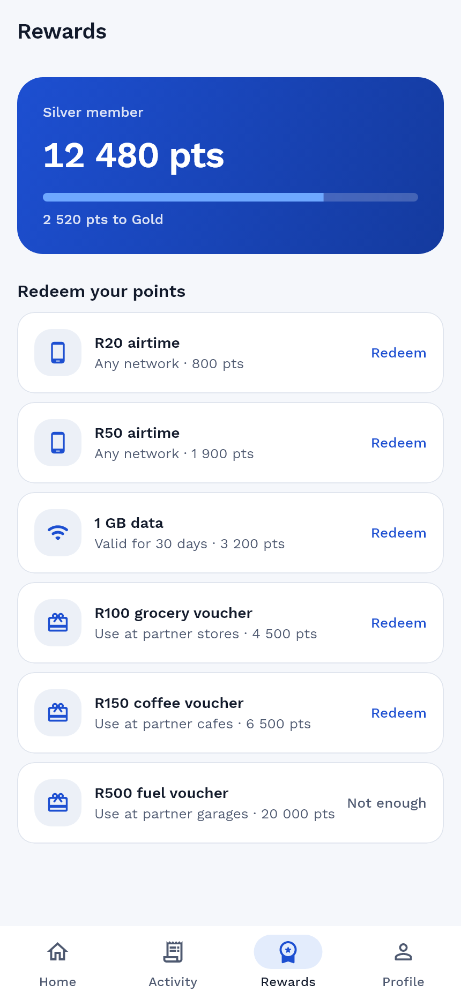
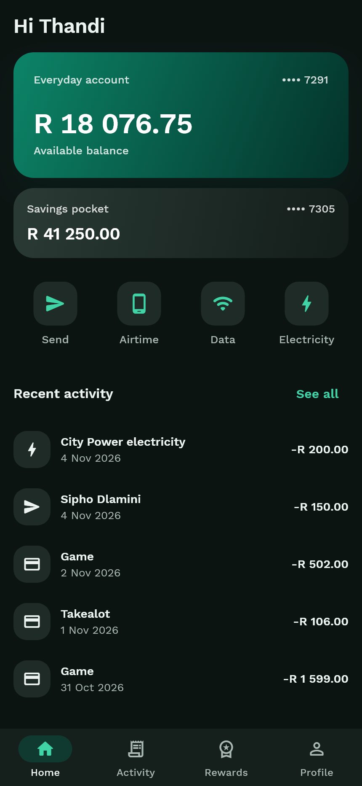
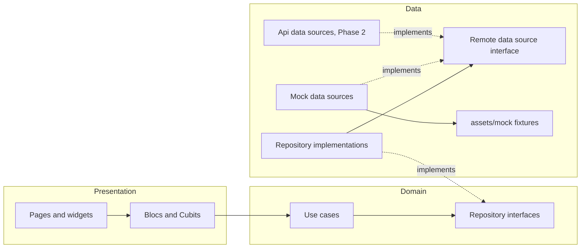

# Wallet

[](https://github.com/AzTheProgrammer/wallet-demo-app/actions/workflows/ci.yml)


A South African banking wallet built with Flutter: pay people, buy airtime, data and prepaid electricity, and redeem rewards. No real money moves. Everything runs on in-app mock data behind the same interfaces a real API will use.

| Home | Activity | Review payment | Electricity receipt | Rewards | Dark mode |
| --- | --- | --- | --- | --- | --- |
|  |  |  |  |  |  |

## Features

- **Sign in:** PIN setup, PIN login, fingerprint or Face ID, lockout after 5 wrong attempts
- **Home:** balance cards with a count-up, quick actions, recent activity, pull to refresh
- **Activity:** infinite scroll, search, filters by type and date, detail screen with a hero transition
- **Send money:** pick or add a person, enter an amount, review, approve with PIN or biometrics
- **Buy:** airtime, data bundles and prepaid electricity, with a 20-digit token on the receipt
- **Rewards:** points, tiers, and redeeming points for airtime, data or vouchers
- **Profile:** personal details, change PIN, biometrics toggle, light and dark themes
- **Developer menu:** tap the version label on Profile 7 times to change the failure rate, simulate being offline or open the design system

Every flow has loading, empty, error and offline states. Loading uses skeletons, motion respects the system's reduced-motion setting, and text scales to 1.5x.

## Architecture

Feature-first Clean Architecture. Dependencies point inward, and `domain` is pure Dart.



```text
lib/
  core/            theme, routing, DI, errors, mock server, shared widgets
  features/
    auth/          each feature has domain/, data/ and presentation/
    dashboard/
    transactions/
    send_money/
    vas/
    rewards/
    profile/
assets/mock/       JSON fixtures
test/              unit, bloc and widget tests
integration_test/  end-to-end happy path
```

More detail is in [docs/architecture.md](docs/architecture.md) and [docs/testing.md](docs/testing.md).

## Run it

Generated code is not committed, so run the generator first:

```bash
flutter pub get
```

```bash
dart run build_runner build --delete-conflicting-outputs
```

```bash
flutter run -d chrome
```

Biometrics need a real device or emulator. On web the option shows as unavailable.

## Test it

```bash
make coverage
```

This runs the tests, prints coverage by layer and writes a report to `coverage/index.html`, where you can click through to any file and see its missed lines.

```bash
flutter test integration_test -d <device>
```

## Data source switch

Repositories depend on an abstract remote data source. `configureDependencies` takes a `DataSourceMode`, which picks the matching injectable environment, so switching never touches domain or presentation code.

Phase 1 only ships the mock implementations, so the API option in the developer menu is disabled. Tune the mock server at build time:

```bash
flutter run -d chrome --dart-define=MOCK_FAILURE_RATE=0.2 --dart-define=MOCK_MIN_LATENCY=300 --dart-define=MOCK_MAX_LATENCY=900
```

## Roadmap

- .NET Web API with PostgreSQL, EF Core, JWT auth and Swagger
- Endpoints that mirror the mock contracts
- `Api*DataSource` implementations using `dio`
- Docker Compose for the API and database
- A live mock and API toggle in the developer menu
- API tests with xUnit

## Credits

Work Sans is used under the SIL Open Font License. Merchant and network names in the fixtures are sample data only, and this project is not affiliated with any of them.
