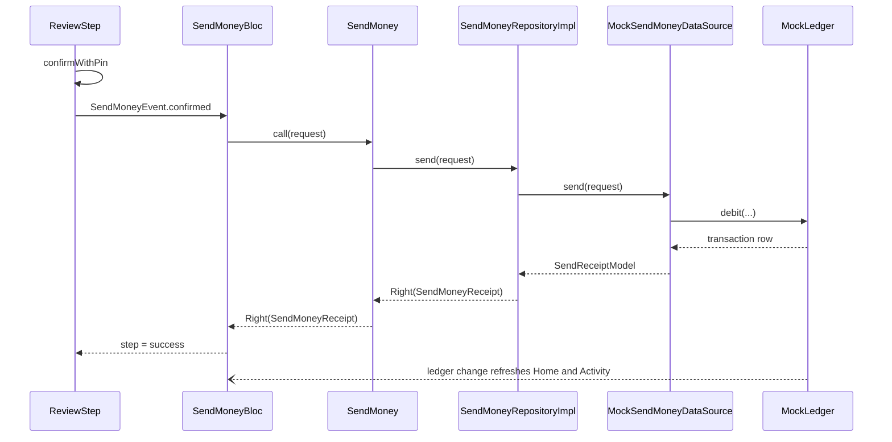

# Architecture

## Layers

| Layer | Holds | May depend on |
| --- | --- | --- |
| `presentation` | Pages, widgets, Blocs and Cubits | `domain`, `core` |
| `domain` | Entities, repository interfaces, use cases | Pure Dart packages only |
| `data` | DTOs, data sources, repository implementations | `domain`, `core` |

`core` holds what features share: design tokens, routing, DI, error types, the mock server and common widgets.

## Data flow

Sending money, from the tap to the mock ledger:

Data sources throw `AppException`s. `guard` in `core/data` turns them into `Either<Failure, T>` at the repository boundary, so no exception crosses a layer.

## Dependency injection

`get_it` and `injectable` build the graph. `configureDependencies(mode:)` registers the `DataSourceMode`, then initialises with that mode's name as the environment. Mock data sources carry `@mockSource`, and Phase 2 data sources will carry `@apiSource`.

`SessionCubit` and `SettingsCubit` are singletons because the router and theme need them for the app's whole life. Every other Bloc is created per route.

## Routing

`go_router` uses a `StatefulShellRoute` so each tab keeps its state. `sessionRedirect` is a pure function from session status and location to a redirect, which keeps the guard easy to test.

## Mock server

`MockServer` loads fixtures once and keeps them in memory, so balances and history stay consistent during a session and reset on restart. Each call waits a random latency, then can fail according to `DemoConfig`. Fixtures store `days_ago` rather than dates so the demo never looks stale.

## Decisions and trade-offs

- **Cubits for simple screens, Blocs for flows.** Send money, purchases and the searchable history have enough events to justify a Bloc.
- **A ledger stream instead of refresh callbacks.** Home and Activity live in separate tabs and both need to update after a payment. A stream exposed through `TransactionRepository` keeps those features unaware of the payment flows.
- **`domain` imports `injectable` and `equatable`.** Both are pure Dart. Annotations on use cases are cheaper than a hand-written registration list.
- **Generated code is not committed.** It keeps diffs readable, at the cost of one extra setup step.
- **PIN hashing is salted, iterated SHA-256.** That suits a demo. A production app should use a memory-hard KDF and verify on the server.
- **Lockout state lives on the device.** A real bank must enforce this on the server, because local state can be cleared.
- **Offline is simulated.** Mock data needs no network, so the developer menu drives the offline state. Phase 2 can add real connectivity checks in the API data sources.
